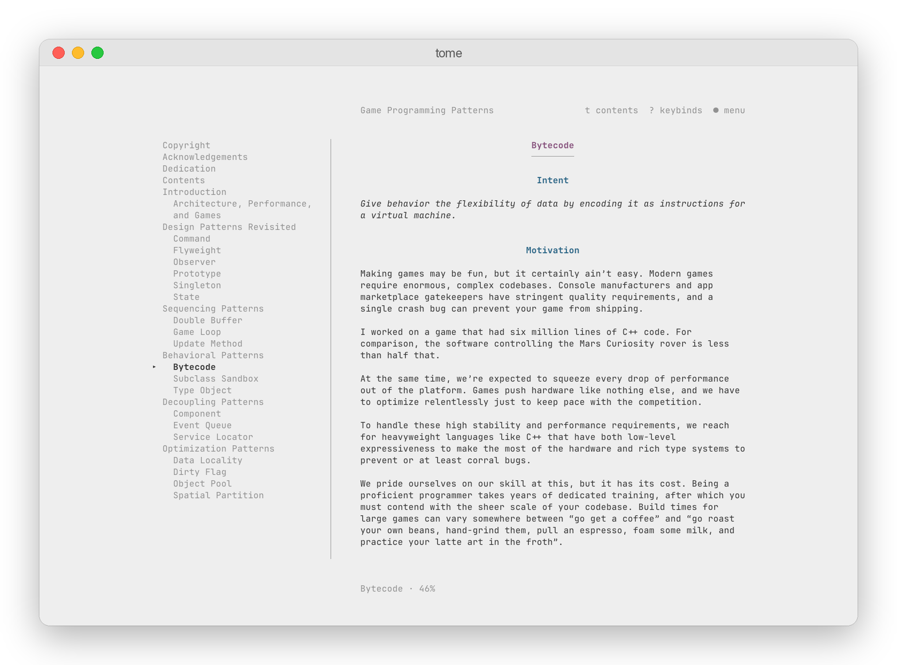
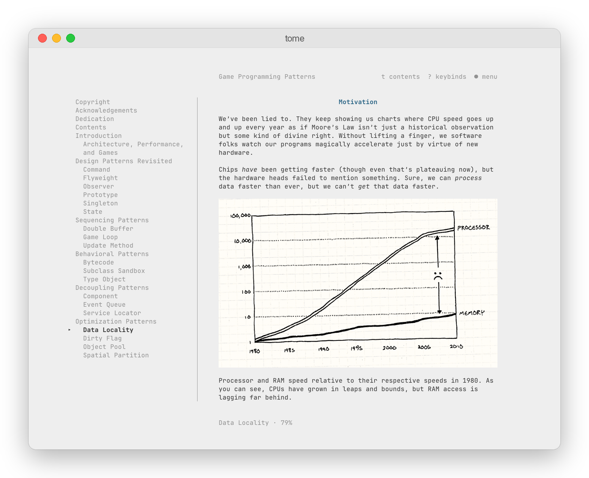
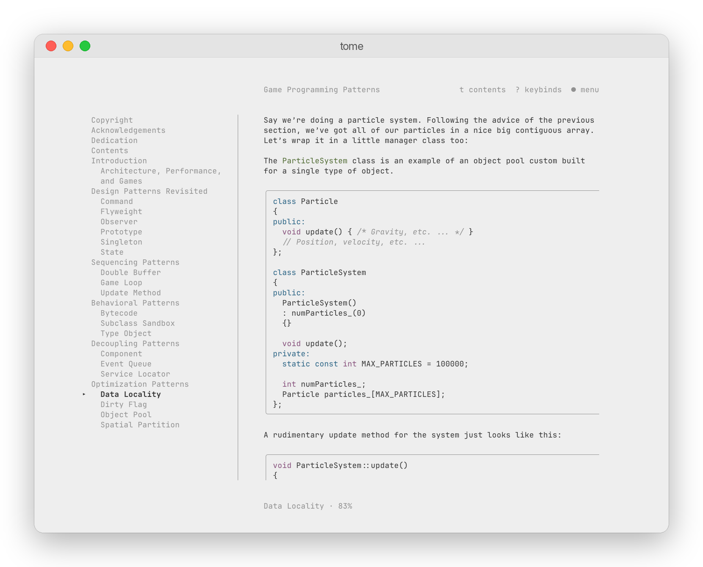

# tome

[](https://github.com/huyphung1602/tome/actions/workflows/ci.yml)
[](https://github.com/huyphung1602/tome/releases)
[](LICENSE)

**A calm EPUB reader for your terminal.**

Open a book, and tome gives you a quiet page: one readable column, a table of contents beside it, and nothing else asking for attention. It remembers where you stopped, finds every book on your machine, and runs anywhere as a single small binary.



## Why tome

- **Reading layout**: a centered column of 72 characters and 36 lines, so your eyes stay in one place on wide screens. The whole book scrolls as one page.
- **Theme colors**: tome has no theme of its own. Headings and code use your terminal's palette.
- **Book picker**: run `tome` to choose from recent books or every EPUB in your home folder. Type to filter, with or without accents.
- **Saved progress**: each book reopens at the paragraph you were reading, even after a window resize.
- **Search and bookmarks**: find any phrase in the book, bookmark paragraphs, and jump back to them later.
- **Keyboard and mouse**: Vim keys, clicks and scrolling all work. Drag over text to copy clean paragraphs.
- **Browser view**: press `o`, or click the book title, to open the book in your browser at the paragraph you're reading. Scrolling in either one moves the other. The page has the same calm frame, with a terminal theme that takes your terminal's colors, a light and a dark theme, and mono, serif or sans text.

### Inline images

On [Ghostty](https://ghostty.org), illustrations and diagrams appear inline with the text. Click one to view it full size with its caption.



### Syntax-highlighted code

Code blocks get a subtle frame and highlighting in your theme's colors, using the book's own markup when it has some. Copy a snippet and it comes out exactly as written.



## Install

macOS, Linux and FreeBSD, no dependencies:

```sh
curl -fsSL https://raw.githubusercontent.com/huyphung1602/tome/main/scripts/install.sh | sh
```

This installs `tome` to `~/.local/bin`. Run it again to update, or delete that file to uninstall.

Prefer a download? Grab the archive for your system from [Releases](https://github.com/huyphung1602/tome/releases), including Windows. If macOS blocks a binary downloaded in the browser, run `xattr -d com.apple.quarantine tome` once. With Go 1.26 or later you can also run `go install github.com/huyphung1602/tome/cmd/tome@latest`.

## Usage

```sh
tome                 # pick a book from your home folder
tome ~/Books         # pick a book from a folder
tome book.epub       # open a book directly
```

The buttons above the text show the most useful keys: `t` for the table of contents, `?` for every keybind, and `m` for the menu.

| Key | Action |
|---|---|
| `space` `b` or `→` `←` | next / previous page |
| `j` `k` | move the cursor line by line |
| `n` `p` | next / previous chapter |
| `/` | search, then `n` `N` between matches |
| `B` and `'` | bookmark a paragraph, list bookmarks |
| `t` | show or hide the contents |
| `-` `+` | shorter or taller page |
| `i` | view the image on screen |
| `o` | open the book in your browser (or click its title) |
| `esc` | step back: close a panel, clear a search, then back to your books |

## Images

tome checks at startup whether your terminal supports the [kitty graphics protocol](https://sw.kovidgoyal.net/kitty/graphics-protocol/).

| Terminal | Images |
|---|---|
| Ghostty, also inside herdr | inline in the text |
| kitty, WezTerm | should work, not yet tested |
| others | an `[Image]` line you can open with `i`, then `o` for your image viewer |

Set `TOME_IMAGES=inline`, `modal` or `off` to choose for yourself.

## Settings

There is no config file. Your reading position, bookmarks and layout are saved in `~/.local/state/tome/` (or `$XDG_STATE_HOME/tome/`). Set `NO_COLOR=1` for plain text without colors.

## Development

```sh
go test ./...
go run ./cmd/tome book.epub
scripts/build.sh     # release archives for every platform in dist/
```

Push a tag like `v1.0.0` and GitHub Actions builds every platform and publishes the release. Design notes live in [docs/design.md](docs/design.md).

## License

[MIT](LICENSE). Screenshots show [Game Programming Patterns](https://gameprogrammingpatterns.com) by Robert Nystrom.
