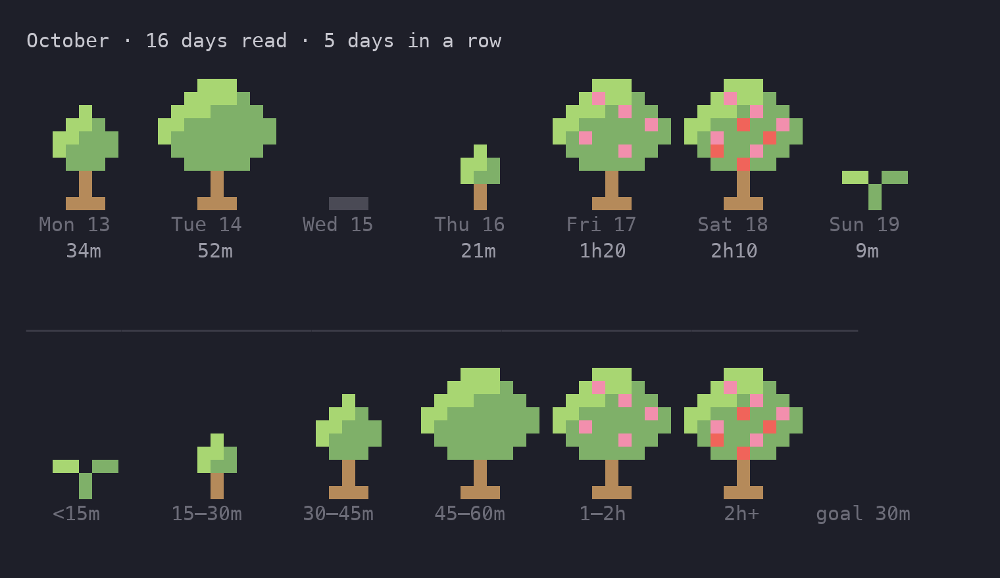

# Reading garden

A habit tracker built into tome: it counts the minutes spent reading each day, across every book, and draws them as a garden of trees, one tree per day, grouped by week and month. The bigger the tree, the longer you read.

## Intent

- **Goal:** make reading every day feel rewarding. What counts is the time spent with a book, not how far you got or how many pages you turned.
- **For:** anyone using tome, with nothing to set up. Opening a book and reading is enough.
- **Success:** run `tome` and see at a glance whether you read today, how long, and how many days in a row.

### Decisions so far

- Only time is measured. Reading forward, scrolling back, rereading and jumping around all count the same.
- Tracking is always on, for every book. There is no plan, no opt-in, and no splitting books into daily parts.
- There is one garden for all books, like a contributions graph across every repository.
- A day runs 04:00 to 04:00, and the streak keeps yesterday's run until today is read (both approved).
- Idle rule: a gap of more than 3 minutes with no activity is idle and isn't counted.
- The garden is laid out by week (rows), grouped by month.
- Terminal first. The browser view can draw it later.

## Measuring time

**Activity** is anything the reader does inside an open book:

- a key, a wheel scroll, a click or a drag;
- a position update from the browser view.

Opening menus counts too. The point is "someone is here", not "the text moved".

**Counting.** The reader keeps the time of the last activity.

- On each new activity, the gap since the previous one is added to today's reading time, capped at 3 minutes.
- A gap longer than 3 minutes therefore adds exactly 3 minutes and no more. Walking away, a sleeping laptop and a frozen terminal all cost at most 3 minutes.
- Opening a book counts as activity, so the first minutes count from there.
- When the terminal reports that it lost focus (Bubble Tea `FocusMsg`/`BlurMsg`, enabled with `tea.WithReportFocus`), counting stops until focus returns.

**Days.** A day runs from 04:00 to 04:00 local time. Reading past midnight belongs to the evening it started in. A gap that crosses 04:00 is split between the two days.

**Saving.** Time is saved every minute while reading and again when the book closes. A crash loses at most a minute.

## Storage

Each book's state file (`~/.local/state/tome/<key>.json`) gets a map from day to seconds:

```json
"reading": { "2026-10-21": 1520, "2026-10-22": 380 }
```

The reader never writes totals. Each save hands over only the seconds counted since the last save, and they are added to what the file holds at that moment. Two tome windows, even on the same book, therefore never overwrite each other's time.

The garden adds up every state file, the way `state.Recent` already reads them all for the picker: `state.Reading(dir, skip)` returns seconds per day per book title, leaving out one book (the one being read, whose live time the reader adds itself). Days are kept forever: about 20 bytes a day, a few KB a year.

Prefs gain one field, `daily_minutes` (default 30), the daily goal trees are measured against. A goal most days can reach keeps the garden encouraging; long days are what grow the flowers and fruit.

## Trees

Size comes from today's minutes divided by the goal:

Trees are pixel art, 9 pixels wide and 10 tall, drawn with the upper half block `▀`: each cell shows two vertically stacked pixels, the top one as the foreground color and the bottom one as the background, so a tree takes 9 columns and 5 rows. Terminal cells are about twice as tall as they are wide, so the pixels come out square.

| Read (vs. goal) | Tree |
|---|---|
| nothing (a past day) | a patch of bare ground |
| under 50% (< 15 min) | sprout: two leaves on a stem |
| 50 to 100% (15–30 min) | sapling |
| 100 to 150% (30–45 min) | tree |
| 150 to 200% (45–60 min) | big tree with a wide crown |
| 200 to 400% (1–2 h) | big tree with flowers |
| 400% or more (2 h +) | big tree with flowers and fruit |
| future day | a faint `·` |

The pixel grids (`.` empty, `L` light leaf, `g` leaf, `T` trunk, `F` flower, `R` fruit, `d` ground):

```
sapling      tree         big          flowers      fruit
.........    .........    ...LLL...    ...LLL...    ...LLL...
.........    .........    ..LLLLg..    ..LFLLg..    ..LFLLg..
.........    ....L....    .LLLgggg.    .LLLgFgg.    .LLLgFgg.
.........    ...LLg...    LLggggggg    LLgggggFg    LLggRggFg
.........    ..LLggg..    Lgggggggg    LgFgggggg    LgFgggRgg
....L....    ..Lgggg..    .ggggggg.    .ggggFgg.    .gRggFgg.
...LLg...    ...ggg...    ..ggggg..    ..ggggg..    ..ggRgg..
...Lgg...    ....T....    ....T....    ....T....    ....T....
....T....    ....T....    ....T....    ....T....    ....T....
....T....    ...TTT...    ...TTT...    ...TTT...    ...TTT...
```

The sprout is `..LL.gg..` / `....g....` / `....g....` on the bottom three pixel rows, and bare ground is `...ddd...` on the last.

Minutes in parentheses are for the default 30-minute goal.

- Colors come from the terminal's palette, so the theme decides the actual shades: leaves green (ANSI 2) with bright green (10) highlights, trunk yellow (3, brown in most themes), flowers bright magenta (13), fruit bright red (9), ground bright black (8).
- Under `NO_COLOR` the trees are drawn with full and half blocks in the default color; the shapes alone show the size.
- With a column between trees a week takes 69 columns and fits inside tome's 72-column frame. Below each tree go the day and its minutes (`Tue 14` / `52m`); a week row is 7 lines.
- **Legend.** The full garden ends with the six levels drawn as trees, each labeled with its minutes for the current goal (`<15m`, `15–30m`, `30–45m`, `45–60m`, `1–2h`, `2h+`), then `goal 30m/day · + −`. The scale explains itself.

The approved look is in the preview rendered during design (): a week of trees with day and minutes under each, a rule, then the legend row.

## Screens

**Book picker (running `tome`).** Above the recent books: a summary line (`♣ 5 days in a row · today 12 of 30 min`), then this week's row of 7 trees with days and minutes. Clicking the row, or pressing `ctrl+g` (plain letters filter the list), opens the full garden. When the terminal is too short for the row and at least 5 book rows, the picker shows only the summary line.

**In a book.** The status line shows today's time: `today 12/30m`. The menu (`m`) gains a "garden" entry that opens the full garden.

**Full garden.** Week rows, Monday to Sunday, newest at the bottom, scrolled to the current week when it opens. Each month starts with a heading: `October · 16 days read · longest streak 6`.

- `j`/`k` and the wheel scroll.
- Arrow keys or a click select a day, and the status line shows its minutes per book: `Tue 21 · 34m · Lược Sử Vạn Vật 22m, Homo Deus 12m`. Per-book minutes come from each book's own map.
- `esc` goes back.
- With no data yet it says "read a book and your first tree grows here".

**Daily goal.** The full garden's status line legend line ends with `goal 30m/day · + −`; `+`/`-` change it in steps of 5 minutes (5 to 120), and the legend follows. Changing the goal redraws every past tree against the new goal, since trees are computed and never stored.

**Streak.** Days in a row with at least one minute read. Today counts once you've read; until then the streak shows yesterday's run, so it doesn't reset in the morning.

## Out of scope

- Splitting books into daily parts, plans and deadlines.
- Reading speed, pages or words read.
- Notifications or reminders.
- Drawing the garden in the browser view. The data model allows it later.
- Image trees on terminals with kitty graphics. Text first.

## Testing

- **Counting:** feed timed activity events into the counter. Cover a normal session, a 10-minute gap (adds 3), losing and regaining focus, and a gap across 04:00 (split between days).
- **Storage:** time saved and loaded with the state file, old state files without `reading` load fine, and per-day sums across several books.
- **Trees:** the level for each ratio boundary (0, 50, 100, 150, 200%) and the future-day dot.
- **Rendering:** the picker strip and the full garden at 72 columns, with and without `NO_COLOR`. Week rows align on Monday, and month headings fall in the right place.
- **Streak:** gaps, today not read yet, and today read.
